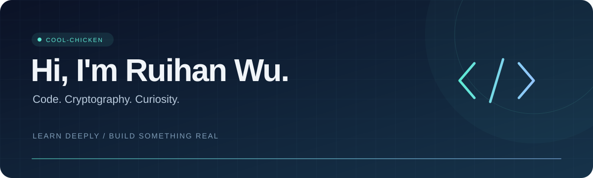

  

  <a href="https://github.com/cool-chicken?tab=repositories">Projects</a> ·
  <a href="https://blog.csdn.net/Rachelbb8">Writing</a> ·
  <a href="#connect">Connect</a>

  <b>在代码里探索原理，把想法变成可以运行的东西。</b> 
  Exploring cryptography, building projects, and learning along the way.

---

### 01 / About me

Hi, I'm **Ruihan Wu**, also known as **cool-chicken** 👋

- 🔐 对 **Cryptography** 和编程充满好奇，喜欢弄清技术背后的原理。
- 🛠️ 通过实验、项目和可视化，把学到的知识变成具体实现。
- 📝 在 [CSDN](https://blog.csdn.net/Rachelbb8) 记录学习过程，分享遇到的问题与思考。

### 02 / Project shelf

| 方向 | 项目 | 探索内容 |
| :--- | :--- | :--- |
| 🔐 Cryptography | [cryptography-exp](https://github.com/cool-chicken/cryptography-exp) | 密码学实验与代码 |
| 🌐 Networks | [GBN protocol animation](https://github.com/cool-chicken/GBN-protocol-animation-python) | 用 Python 动画展示 GBN 协议 |
| 🧠 Machine learning | [Hand-Tear-ML-Code](https://github.com/cool-chicken/Hand-Tear-ML-Code) | 机器学习算法的代码实践 |
| 📐 Modeling | [CUMCM2023–2024](https://github.com/cool-chicken/CUMCM2023-2024) | 数学建模相关实践 |

  <a href="https://github.com/cool-chicken?tab=repositories">Explore all repositories →</a>

### 03 / Toolbox

  

### 04 / Activity

[查看我的 GitHub 贡献与近期活动 →](https://github.com/cool-chicken?tab=overview)

### 05 / Connect

  
  
  

---

  Stay curious. Keep building. 🐣

